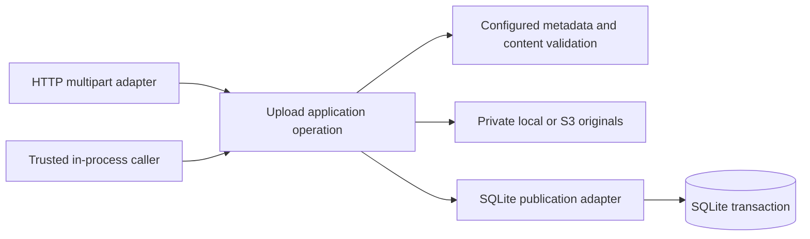

# Architecture and trust model

HomeAtlas is a modular monolith: one Go process, an embedded Vue client and SQLite. `internal/app` composes identity, registry, file collections, storage, backup participants and the WASI engine. `cmd/homeatlas` starts that application and supplies local administrative commands. The runtime does not depend on Proxmox or Tailscale.

| Boundary | Responsibility |
| --- | --- |
| `cmd/homeatlas` | Flags, process lifecycle and local CLI |
| `internal/app` | Composition, request coordination, household backups and settings |
| `internal/core/identity`, `access` | Session identity, household membership and capabilities |
| `internal/core/collections` | Host-controlled metadata, originals and explicit sharing |
| `internal/core/objectstore` | Authorized local/S3 original storage and moves |
| `internal/core/modules` | Catalog, activation and host module contracts |
| `internal/core/plugins` | Package approval, WASI execution, constrained storage ABI and backup adapters |
| `plugins/documents` | Independent file-collection validation and presentation |
| `sdk/pluginstorage` | Experimental guest-side ABI, without host internals |
| `apps/web` | Session client, shared components and declarative module renderers |

## Application operations and adapters

The upload path separates multipart/HTTP handling in `collections/files.go`, application orchestration in `collections/upload.go` and transactional SQLite publication in `collections/upload_sql.go`. `Module.Upload(context, UploadInput)` accepts a filename, metadata bytes and an `io.Reader`, and returns an item or a domain error. It streams once into private staging, validates, flushes, prepares optional remote storage and commits metadata plus object location together. Failure removes local staging and aborts unpublished remote objects.

In-process callers supply authenticated principal context and must run through the application backup coordination gate. Identity, permissions, current membership and module activation are rechecked before upload publication. This method is an internal host API, not a way for WASI guests or external callers to supply identity. HTTP supports metadata before or after the file without a second full copy.

Identity now has an `Application` with typed input/result records and classified failures. `identity/http.go` owns decoding, cookies, CSRF, routes and HTTP status mapping; repositories in `*_sql.go` own queries, scans and migrations. Login, recovery, invitations, membership changes, assisted enrollment, PIN devices, email verification and household settings reuse the application operations without HTTP. The local recovery CLI uses the same repository.

Collection list/search/detail/update/sharing operations use typed repository methods. Metadata validation stays in the application, including direct update calls. Membership, read/write/share permissions, ownership and module activation are rechecked inside the committing transaction. Registry state, Local/S3 settings and moves, scheduled backup history and private/shared plugin storage follow the same policy/persistence boundary. SQL belongs in explicit `*_sql.go` adapters; the composition root supplies SQLite connections.

`access.Directory` and authorization callbacks accept `unitofwork.Transaction` (commit/rollback only), without `database/sql`. The same native transaction reaches all SQL adapters, so a failed identity, grant, original-location or module write cannot publish a partial change. Rate counters retain their existing separately committed transaction. `unitofwork.ErrNotFound` is independent of the driver; adapters retain SQL error compatibility for existing backup integrations.

Backup snapshot codecs and the trusted `backup.Provider` contract intentionally remain SQLite-specific. Snapshot serialization, migrations and composition are infrastructure boundaries, not portable application ports. Backup coordination remains in `internal/app`; trusted direct callers must use its gate. No claim of interchangeable database engines or multi-process coordination is made. `internal/architecture` checks that application/HTTP code cannot reintroduce direct SQL calls and that identity application code cannot import HTTP.

## Security boundaries

- Cookie sessions establish identity; headers and plugin inputs cannot choose a household or acting user. Cross-origin writes are rejected.
- Membership IDs distinguish removal/rejoining; historical grants do not revive automatically.
- Private originals require ownership or explicit recipient access. Administrative status alone does not grant browsing access to every document.
- An authorized household owner can export household-private module data in a full backup. Backup encryption does not encrypt the live database or originals.
- Approved guests receive bounded WASI stdin/stdout and declared storage calls. They receive no direct SQL, mounted filesystem, network, host environment or cloud credentials. A digest checks integrity; it is not a publisher signature.
- Slow JSON bodies are read with a bounded prefix before global locks. Queued requests can cancel. Writes remain serialized for consistency; export freezes writes and restore excludes reads and writes.

## Operating limits

| Area | Current boundary |
| --- | --- |
| Deployment | One process per data directory; no multi-node or shared-directory coordination |
| Database | SQLite WAL, one connection configured; locks/jobs are in-process |
| File original | At most 20 MiB; a collection may declare a lower maximum |
| Whole backup | Up to about 1 GiB and 10,000 files, plus format/snapshot limits |
| Installed plugins | At most 8 |
| Guest execution | One action globally; 32 MiB guest linear memory; 1-second execution within a 6-second cold/runtime budget |
| Compiler memory | Separate from guest linear memory; only the most recently compiled guest is cached |
| Storage SDK | 16 KiB value, 128 KiB RPC envelope, 64 calls/action and up to 64 keys/page |
| Distribution | Automated executable currently Linux amd64; source builds support other tested development hosts |

These are enforced limits and design constraints, not a tested family/member/document capacity or universal RAM guarantee. S3 moves originals, while SQLite, package receipts and scheduled backup archives remain local. See [recovery requirements](../deployment/systemd.md#backups-and-rollback).
