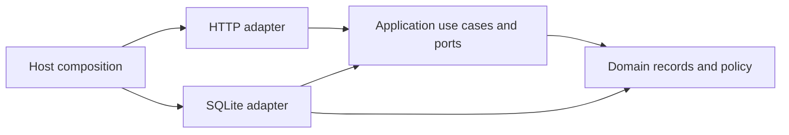

# Architecture and trust model

HomeAtlas is a modular monolith: one Go process, an embedded Vue client and SQLite. `internal/app` composes identity, registry, file collections, storage, backup participants and the WASI engine. `cmd/homeatlas` starts that application and supplies local administrative commands. The runtime does not depend on Proxmox or Tailscale.

| Boundary | Responsibility |
| --- | --- |
| `cmd/homeatlas` | Flags, process lifecycle and local CLI |
| `internal/app` | Composition, request coordination, household backups and settings |
| `internal/core/identity`, `access` | Session identity, household membership and capabilities |
| `internal/core/collections` | Host-controlled metadata, originals and explicit sharing |
| `internal/core/objectstore` | Authorized local/S3 original storage and moves |
| `internal/core/modules` | Catalog, activation and host module contracts |
| `internal/core/plugins` | Package approval, WASI execution, constrained storage ABI and backup adapters |
| `plugins/documents` | Independent file-collection validation and presentation |
| `sdk/pluginstorage` | Experimental guest-side ABI, without host internals |
| `apps/web` | Session client, shared components and declarative module renderers |

## Domain, application and adapters

Identity, collections, module registry, original storage and plugin execution/storage have separate Go packages:

```text
internal/core/<feature>/
  domain/                records, validation and policy
  application/           use cases and the ports they consume
  adapters/http/         routes, decoding, cookies and HTTP responses
  adapters/sqlite/       queries, scans, migrations and snapshot codecs
```

Only relevant adapters exist for each feature. Collections also has filesystem and remote-original adapters; object storage has S3 and local credential-encryption adapters; plugins have package-installation and WASI adapters. Shared `access`, `fault` and `unitofwork` contracts remain small, transport-independent packages. Backup streaming/cache advice lives in `backup/stream` so application code does not import the SQLite snapshot contract.



Source dependencies point toward application/domain. These packages have no direct or transitive dependency on `database/sql`, `net/http`, AWS, wazero or implementation adapters. `TestLayerDependencies` checks the compiled Go dependency graph; `TestPersistenceBoundaries` restricts direct SQL to adapters and the existing host snapshot infrastructure.

The feature root packages are assembly facades for trusted host callers. They construct adapters and retain the existing host entry points/types; application packages never import these facades. `internal/app` composes the complete process and owns the global request/backup coordination boundary. Database initialization, SMTP delivery and the trusted SQL snapshot contract are infrastructure, rather than artificially empty domain/use-case packages.

`identity/application` owns account lifecycle, authentication and household administration. Its persistence ports are grouped by account installation, authentication, alternative access, invitations, memberships, recovery and settings. `identity/adapters/http` owns cookies, CSRF, JSON and status mapping. `Application.Authenticate(context, token)` supplies the same authenticated context to HTTP and trusted in-process callers and clears a previous identity on failure.

`collections/application` owns list/search/detail/update/sharing and streaming upload operations. Filesystem, content inspection and remote publication use injected ports. The HTTP adapter preserves multipart metadata before/after the original without a second full copy. SQL FTS escaping belongs to the SQLite adapter. Internal original keys and membership bindings remain excluded from public JSON after moving records to the domain package.

`unitofwork.Transaction` exposes only commit/rollback. Identity, registry and collection/storage repositories still share the same committing scope for current membership/permission checks and data/grant/original-location writes. Authorization is rechecked inside that scope. Rate counters preserve their separate durable commits. Trusted in-process callers must still pass through the global backup coordination gate.

Plugin application code stages private/shared storage calls, checks current permissions/revisions and commits after successful execution. The WASI adapter owns imports, linear memory, runtime cache and deadlines. The application keeps the execution context alive through output validation and storage commit. Guest import `homeatlas_storage_v1`, wire fields, limits, consent receipts and contract version remain unchanged; existing `.hap` packages and `sdk/pluginstorage` need no migration.

Backup snapshot codecs and `backup.Provider` intentionally remain SQLite-specific infrastructure. Their schemas/versions and migration SQL bytes are unchanged. The host coordinator in `internal/app` retains its one-process consistency gate; this refactor does not introduce interchangeable database engines or multi-process coordination.

Startup maintenance runs under an exclusive data-directory lock, before requests/workers. The recovery filesystem adapter removes known workspaces and quarantines unreferenced collection originals; SQLite adapters supply references across all households. New remote uploads use the existing durable cleanup queue before PUT and consume the intent in the publication transaction. See [crash recovery and its limits](../deployment/crash-recovery.md).

## Security boundaries

- Cookie sessions establish identity; headers and plugin inputs cannot choose a household or acting user. Cross-origin writes are rejected.
- Membership IDs distinguish removal/rejoining; historical grants do not revive automatically.
- Private originals require ownership or explicit recipient access. Administrative status alone does not grant browsing access to every document.
- An authorized household owner can export household-private module data in a full backup. Backup encryption does not encrypt the live database or originals.
- Approved guests receive bounded WASI stdin/stdout and declared storage calls. They receive no direct SQL, mounted filesystem, network, host environment or cloud credentials. A digest checks integrity; it is not a publisher signature.
- Slow JSON bodies are read with a bounded prefix before global locks. Queued requests can cancel. Writes remain serialized for consistency; export freezes writes and restore excludes reads and writes.

## Operating limits

| Area | Current boundary |
| --- | --- |
| Deployment | One process per data directory; no multi-node or shared-directory coordination |
| Database | SQLite WAL, one connection configured; locks/jobs are in-process |
| File original | At most 20 MiB; a collection may declare a lower maximum |
| Whole backup | Up to about 1 GiB and 10,000 files, plus format/snapshot limits |
| Installed plugins | At most 8 |
| Guest execution | One action globally; 32 MiB guest linear memory; 1-second execution within a 6-second cold/runtime budget |
| Compiler memory | Separate from guest linear memory; only the most recently compiled guest is cached |
| Storage SDK | 16 KiB value, 128 KiB RPC envelope, 64 calls/action and up to 64 keys/page |
| Distribution | Automated executable currently Linux amd64; source builds support other tested development hosts |

These are enforced limits and design constraints, not a tested family/member/document capacity or universal RAM guarantee. S3 moves originals, while SQLite, package receipts and scheduled backup archives remain local. See [recovery requirements](../deployment/systemd.md#backups-and-rollback).
